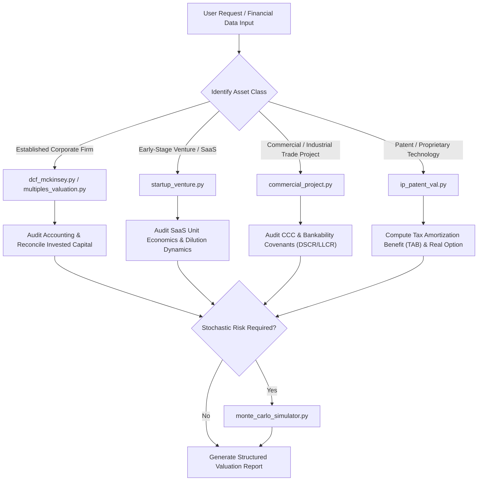

# 🏛️ Enterprise Valuation Engine: Universal Master Skill

## 1. Overview & Capabilities
The `enterprise-valuation` skill equips AI agents to execute rigorous, institutional-grade valuation analysis across four distinct commercial asset classes:
1. **Established Corporate Enterprises:** McKinsey 8th Ed. Key Value Driver DCF, NOPAT, Invested Capital reconciliation, ROIC trees, Economic Profit (EVA), and Damodaran distress bridges.
2. **Trading & Transaction Multiples:** Harmonized peer group analysis using harmonic mean ratios (EV/EBITDA, EV/EBIT, P/E) and value-driver regressions.
3. **High-Growth Startups & Tech Ventures:** VC Method, Bill Payne Scorecard, Berkus Method, First Chicago scenarios, and SaaS unit economics auditing (LTV/CAC, Payback, Rule of 40).
4. **Commercial Trade & Industrial Projects:** UNIDO feasibility metrics, Cash Conversion Cycle (CCC), CFADS, DSCR covenants, LLCR, PLCR, and project finance break-even analysis.
5. **Intellectual Property & Patents:** Relief-from-Royalty, Multi-Period Excess Earnings Method (MPEEM), and Black-Scholes Real Options.
6. **Probabilistic Simulation:** Monte Carlo stochastic engine with Tornado sensitivity rankings.

---

## 2. Trigger Conditions
Activate this skill when the user or prompt asks for:
- Corporate DCF valuation, Enterprise Value (EV), or Equity Value per share.
- WACC calculation, Cost of Equity ($K_e$), or Cost of Debt ($K_d$).
- McKinsey Invested Capital, NOPAT, or ROIC decomposition.
- Pre-money or post-money startup valuation, cap table dilution, or VC Method analysis.
- SaaS unit economics audit (ARR, churn, LTV/CAC, payback period, Rule of 40).
- Project finance bankability review, debt service coverage ratio (DSCR), or UNIDO feasibility.
- Patent valuation, technology license royalty rate, MPEEM, or R&D real options.
- Monte Carlo valuation distribution or sensitivity tornado charts.

---

## 3. Workflow & Diagnostic Execution Tree



---

## 4. Standalone CLI Executable Scripts

All engines are located in `scripts/`:

### A. Corporate Enterprise DCF
```bash
python scripts/dcf_mckinsey.py --input ../../models/sample_corporate_dcf.json --format markdown
```

### B. Comparable Multiples Valuation
```bash
python scripts/multiples_valuation.py --input ../../models/sample_peers_multiples.json --format markdown
```

### C. Startup & Venture Capital Engine
```bash
python scripts/startup_venture.py --input ../../models/sample_startup_saas.json --format markdown
```

### D. UNIDO Commercial Feasibility Engine
```bash
python scripts/commercial_project.py --input ../../models/sample_trade_project.json --format markdown
```

### E. Patent & IP Valuation Engine
```bash
python scripts/ip_patent_val.py --input ../../models/sample_patent_ip.json --format markdown
```

### F. Monte Carlo & Sensitivity Simulator
```bash
python scripts/monte_carlo_simulator.py --input ../../models/sample_monte_carlo.json --format markdown
```

---

## 5. Built-in Sanity & Governance Audits
1. **Perpetual Growth Audit:** Warns if perpetual growth $g$ exceeds long-term GDP growth or risk-free rate.
2. **Economic Moat Audit:** Warns if terminal ROIC exceeds WACC by $>10\%$ without explicit competitive barrier proof.
3. **VC Dilution Audit:** Flags if required current equity ownership exceeds $100\%$.
4. **SaaS Health Audit:** Flags $\text{LTV/CAC} < 3.0x$, $\text{Payback} > 12 \text{ months}$, or $\text{Rule of 40} < 40\%$.
5. **Project Bankability Audit:** Flags if any period's $\text{DSCR} < 1.30x$ or $\text{LLCR} < 1.40x$.
